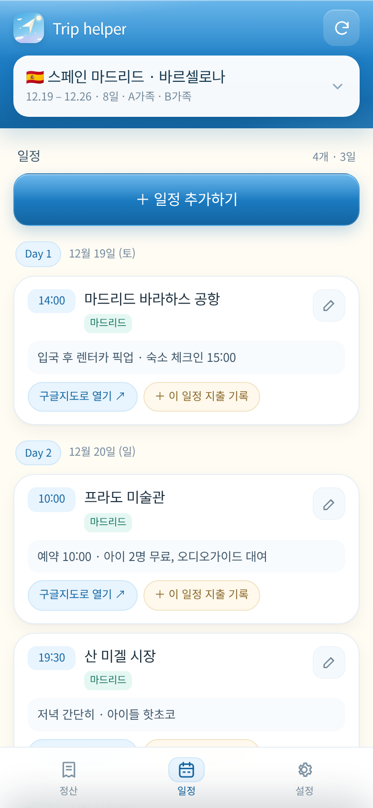
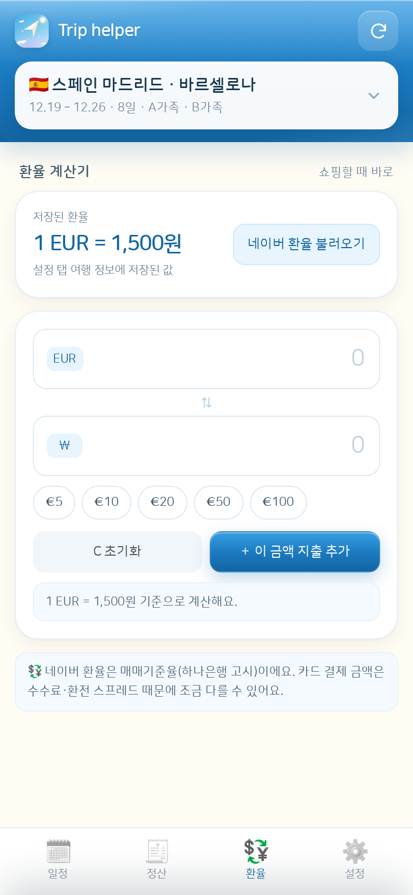
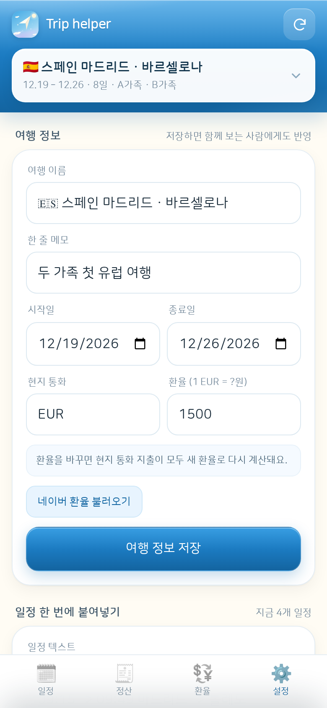

# Trip helper✈️

두 가족, 그리고 친구들이 함께 쓰는 **여행 정산 + 일정 보드** PWA.
링크 하나만 공유하면 로그인 없이 같은 보드를 보며, 지출과 일정이 몇 초 안에 서로에게 반영됩니다.

<p align="center">
  
  
  
  
  
</p>

## 기능

- **일정 · 정산 · 환율 · 설정 4탭 구조** — Cart helper처럼 상단에는 글로시 하늘색 바(아이콘·Trip helper·여행 선택·새로고침)만, 아래에는 이모지 고정 탭 바(`🗓️ 일정`·`🧾 정산`·`💱 환율`·`⚙️ 설정`). 앱을 열면 첫 탭인 `일정`이 가장 먼저 보입니다. 여행 이름·참여자·공유 링크·동기화 상태는 모두 `설정` 탭으로 모읍니다.
- **환율 계산기 탭** — 현지 통화 ↔ 원화를 양방향으로 즉시 계산(빠른 금액 칩 `€5·€10·€20·€50·€100`, 초기화, 계산한 금액을 바로 `＋ 이 금액 지출 추가`). `네이버 환율 불러오기`로 네이버 매매기준율(하나은행 고시)을 받아 계산에 바로 적용하고, `이 환율 저장`으로 여행 환율에 반영합니다(JPY·VND·IDR은 네이버 100단위 고시를 1단위로 환산).
- **링크 하나로 공유** — 여행마다 6자리 코드(`/t/ABCDEF`)가 생기고, 링크를 받은 사람은 로그인 없이 바로 참여합니다.
- **실시간 동기화** — 5초 폴링 + 탭/앱 복귀 시 즉시 동기화. 한쪽 폰에서 지출을 넣으면 다른 폰에 자동 반영됩니다(입력 중인 모달은 방해하지 않음).
- **멀티 여행** — 스페인 여행, 다음 여행을 각각 만들어 전환. 여행별 이름·기간·현지 통화·환율을 관리합니다.
- **참여자 2명~30명** — 가족/팀(어른·아이 수) 또는 개인(1명) 단위로 자유롭게 추가·이름 변경·삭제. 두 가족이든 친구 5명이든 같은 방식으로 씁니다.
- **정산 탭 순서** — 정산할 금액 카드 → `＋ 지출 추가하기` → 지출 내역 → 참여자별 정산 순으로 놓아, 자주 보는 금액과 지출이 위에 오고 참여자별 정산은 맨 아래에 둡니다.
- **분담 방식 5가지**
  | 방식 | 설명 |
  | --- | --- |
  | 똑같이 나누기 (1/N) | 참여자 수로 균등 분할 |
  | 전체 인원 비례 | 어른+아이 인원수 비례 (가족 여행) |
  | 어른 인원 비례 | 어른 수 비례 (아이 경비 제외) |
  | 선택한 사람끼리 | 택시·커피처럼 같이 쓴 사람만 체크해 1/N |
  | 직접 금액 입력 | 사람마다 낼 금액을 직접 지정 (합계가 다르면 비율로 맞춤) |
- **일정 & 구글지도** — 일차별 카드, 장소·지역·메모(예약번호), `구글지도로 열기 ↗` 버튼. 지도 URL을 붙여넣지 않아도 장소명으로 검색 링크가 만들어집니다. 카드에서 바로 `+ 이 일정 지출 기록`으로 연결.
- **여행 중엔 오늘부터** — 기기 현지 날짜 기준으로 여행 중이면 오늘 일차(`오늘` 배지)가 `＋ 일정 추가하기` 바로 아래 맨 위에 오고, 지나간 날 일정은 `지난 일정 N일 (M개) 보기 ▾` 1줄 토글로 접어 둡니다. 여행 전·여행 뒤에는 지금처럼 Day 1 부터 전부 보입니다.
- **PWA** — 아이폰 사파리 `공유 → 홈 화면에 추가`로 앱처럼 실행(standalone, 아이콘, safe-area 대응, 16px 입력으로 확대 방지, 서비스워커 `trip-helper-v12`).
- **4자리 입장 비밀번호(선택)** — 서버에 PIN 을 설정하면 앱을 열 때 4자리 키패드 잠금 화면이 뜨고, 여행 데이터 API 는 인증 없이 내려가지 않습니다. 한 번 맞히면 이 기기에는 토큰이 저장돼 다음부터 묻지 않고, 서버에서 PIN 을 바꾸거나 토큰이 만료되면 다시 입력합니다. `설정 → 입장 비밀번호`에서 현재 PIN 을 확인해 직접 바꿀 수 있고, 바꾸면 다른 기기의 토큰은 즉시 무효가 됩니다.
- **글씨 굵기** — 전체를 한두 단계 가볍게 조정(큰 금액·히어로 숫자·섹션 제목 `600`, 카드 제목·버튼·활성 탭·배지 `500`, 본문·보조 텍스트·입력창·일반 탭 `400`). 일정 카드의 시간 배지만 `600`으로 살짝 도드라지게 했습니다. `700` 이상 굵기는 쓰지 않습니다.
- **디자인** — 미색 바탕(`#FFFCF4`) + 순백 카드 + 글로시 하늘색 상단 바·주요 버튼, 참여자는 파스텔 틴트 사각 아바타(스카이·라일락·민트·피치 등 8색)로 구분. 폰트는 **나눔스퀘어라운드**(`public/fonts/*.woff2` 로컬 서빙, `400·500 = Regular`, `600·700 = Bold`, `-apple-system / Apple SD Gothic Neo / Noto Sans KR` 폴백)로 둥글고 가볍게 보이도록 했습니다.
- **현지 통화 + 원화** — EUR·JPY 등 현지 통화로 적고 기준 통화(KRW)로 환산. 환율을 바꾸면 전체가 다시 계산됩니다.

## 빠르게 실행

```bash
npm install
npm start          # http://localhost:3000
```

- Node.js 20 이상, Express 4.
- 데이터는 `DATA_DIR`(기본 `./data`) 아래 `trips.json` 한 파일에 원자적으로(tmp → rename) 저장됩니다.
- 첫 실행 시 예시 여행 `🇪🇸 스페인 마드리드 · 바르셀로나`(A가족·B가족, 일정 2건)가 만들어집니다. **예시 지출은 넣지 않아 지출 내역 0건으로 시작**하고, 일정 예시는 지우고 쓰면 됩니다.

```bash
npm run dev        # 개발 모드
npm test           # 단위 + API 테스트 (56개)
npm run test:ui    # Playwright 아이폰 390×844 E2E (16단계)
npm run screenshots # 실제 화면 스크린샷 생성
npm run icons      # 홈 화면 아이콘 PNG 재생성 (public/icon-source.svg)
```

## 배포 (Railway 예시)

> 저장소: <https://github.com/yoonyoon0117-crypto/triphelper> (`main`)

1. 이 폴더를 GitHub 저장소에 올리고 Railway에서 **Deploy from GitHub**.
2. **Volume**을 만들어 `/data`에 마운트.
3. 환경변수: `DATA_DIR=/data`, (필요하면) `PORT`는 Railway가 자동 주입.

Docker로 직접 띄울 때:

```bash
docker build -t trip-helper .
docker run -p 3000:3000 -v tripdata:/data -e DATA_DIR=/data trip-helper
```

> Railway는 컨테이너 사용자 때문에 `VOLUME` 지시문이 있으면 마운트가 꼬일 수 있어 Dockerfile에 넣지 않았습니다.

## 공유와 보안

- 여행 링크를 아는 사람은 **누구나** 그 여행의 지출·일정을 보고 고칠 수 있습니다(로그인 없음). 필요한 사람에게만 보내 주세요.
- **4자리 입장 비밀번호**로 앱 전체를 잠글 수 있습니다. `pin.json`(또는 `APP_PIN`)이 있으면 `/api/health`·`/api/pin/*`를 뺀 `/api/trips*`·`/api/exchange-rate*` 요청은 유효한 토큰(쿠키 또는 `X-Trip-Pin-Token`) 없이는 `401`입니다. 잠금 화면이 뜨도록 HTML·CSS·JS·폰트는 인증 없이 내려갑니다(여행 데이터는 내려가지 않음).
- 비밀번호는 `DATA_DIR/pin.json`에 `salt` + `scrypt` 해시로만 저장되고 소스 코드에는 어떤 값도 두지 않습니다. `APP_PIN` 환경변수가 있으면 파일보다 우선합니다.
- 비밀번호를 바꾸면 서명 키(해시·salt)가 바뀌므로 **이전에 발급한 토큰이 모두 즉시 무효**가 됩니다. 첫 설정(`POST /api/pin/setup`)은 PIN 이 없을 때 1회만 되고, 그 뒤에는 `409`로 막힙니다.
- 코드는 추측하기 어려운 6자리(혼동 문자 제외)로 자동 생성되고, 다른 여행 코드와 겹치지 않게 발급됩니다.
- 저장소·테스트·시드 데이터에는 개인정보(실명·전화번호 등)가 들어 있지 않습니다.

## HTTP API

| Method | Path | 설명 |
| --- | --- | --- |
| GET | `/api/health` | 상태 확인 (PIN 잠금과 무관하게 열림) |
| GET | `/api/meta` | 통화 목록, 분담 방식 목록 |
| GET | `/api/pin/status` | `{ locked, unlocked }` (쿠키·`X-Trip-Pin-Token` 으로 인증 여부 판단) |
| POST | `/api/pin/verify` | `{ pin }` 검증 → 토큰(`HttpOnly` 쿠키 + JSON `token`), 틀리면 `401` |
| POST | `/api/pin/setup` | PIN 이 없을 때 1회만 `{ pin }` 설정 (이미 있으면 `409`) |
| POST | `/api/pin/change` | `{ currentPin, pin }` — 현재 PIN 확인 후 변경, 기존 토큰 전부 무효 |
| GET | `/api/trips` | 여행 요약 목록 |
| POST | `/api/trips` | 여행 생성 (`template`: `twoFamilies` \| `friends` \| `solo`, `friendCount`) |
| GET | `/api/trips/:idOrCode` | 여행 전체 + 정산 결과 (`?version=N`이면 변경 없을 때 `{unchanged:true}`) |
| GET | `/api/trips/:id/poll?version=N` | 폴링용(변경 없으면 `unchanged`) |
| PATCH | `/api/trips/:id` | 이름·기간·통화·환율 수정 |
| DELETE | `/api/trips/:id` | 여행 삭제 |
| POST | `/api/trips/:id/participants` | 참여자 추가 |
| PATCH | `/api/trips/:id/participants/:pid` | 이름·형태·인원 수정 |
| DELETE | `/api/trips/:id/participants/:pid` | 삭제 (`?reassignTo=<pid>`: 지출을 넘기고 삭제, 없으면 409) |
| POST/PATCH/DELETE | `/api/trips/:id/expenses[/:eid]` | 지출 CRUD |
| POST/PATCH/DELETE | `/api/trips/:id/itinerary[/:iid]` | 일정 CRUD |

지출 예시:

```json
{
  "title": "공항 택시 (3명)",
  "amount": 90000,
  "currency": "base",
  "payerId": "ptc_ab12cd34ef",
  "date": "2027-01-10",
  "split": { "mode": "select", "participantIds": ["ptc_1", "ptc_2", "ptc_3"] }
}
```

## 정산 규칙

- 모든 금액은 기준 통화(KRW) 정수로 환산한 뒤 나눕니다. 현지 통화 지출은 `금액 × 환율`(원 단위 반올림).
- 한 지출의 부담액은 **최대 잔여법**으로 나눠 합계가 정확히 지출액과 같습니다(반올림 누적 오차 없음).
- 참여자별 `차액 = 낸 금액 − 부담액`을 구하고, 큰 채무자-큰 채권자를 차례로 맞붙여 **참여자 수 − 1건 이하**의 송금 목록을 만듭니다.
- 인원·참여자·환율을 바꾸면 저장된 지출에서 즉시 다시 계산됩니다(지출 데이터는 그대로).

## 구조

```
server.js            Express 앱 (라우팅·검증·정적 파일)
lib/pin.js           4자리 입장 비밀번호 (scrypt 해시·서명 토큰·시도 제한)
lib/settle.js        정산 순수 함수 (분담 계산, 최소 송금)
lib/trips.js         여행·참여자·지출·일정 모델과 검증, 시드
lib/store.js         JSON 원자 저장소 (직렬화 쓰기)
public/index.html    앱 셸
public/app.js        화면·시트·동기화 (바닐라 JS)
public/styles.css    Cart helper 스타일 (글로시 하늘색·미색·파스텔 아바타)
public/manifest.webmanifest, public/sw.js, public/icons/
public/fonts/        나눔스퀘어라운드 woff2 (Regular·Bold, 오프라인 프리캐시)
scripts/             아이콘·스크린샷·E2E 스크립트
test/                단위(settle) + API 통합 테스트
```

## 테스트 현황

- 단위 17개: 환산, 5가지 분담 방식, 인원 변경 재계산, 최소 송금, 반올림 오차, 혼합 통화
- API 19개: 시드, 코드 라우팅, 여행·참여자·지출·일정 CRUD, 409 이관, 최소 2명, 검증 오류, 폴링, 동시 쓰기 10건 무손실, 파일 영속성
- PIN 10개: 미설정 시 통과, 4자리 형식, 1회 설정·중복 409, 미인증 401(여행·환율), 헤더·쿠키 토큰, 만료·변조 토큰, 변경 시 기존 토큰 무효, 평문 미저장, `APP_PIN`, 시도 제한 429
- UI E2E 15단계: 3탭 골격(글로시 바·고정 탭·파스텔 아바타), 로컬 나눔스퀘어라운드 폰트 실로딩·프리캐시, 지출 추가→정산, 설정 탭에서 인원 변경, 호칭 변경 반영, 일정·구글지도·일정→지출, 친구 5명 여행 생성·전환, 두 기기 동기화, `?trip=` 진입, 마지막 여행 삭제, 4자리 PIN 잠금·오답 안내·자동 통과, 설정에서 PIN 변경 시 다른 기기 재잠금, 콘솔 오류 0건
