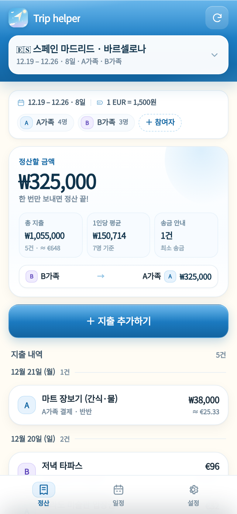
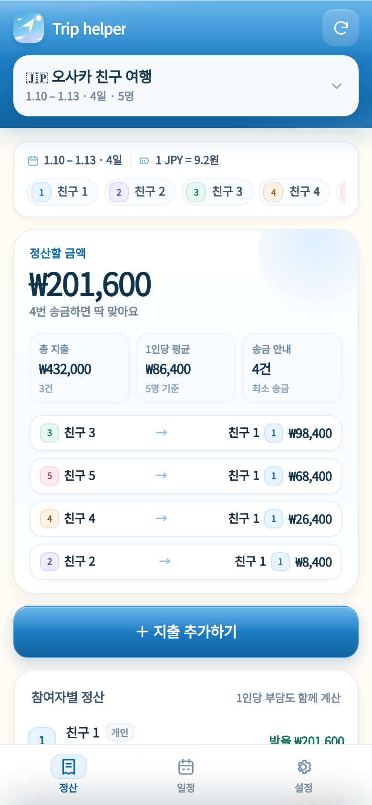

# Trip helper✈️

두 가족, 그리고 친구들이 함께 쓰는 **여행 정산 + 일정 보드** PWA.
링크 하나만 공유하면 로그인 없이 같은 보드를 보며, 지출과 일정이 몇 초 안에 서로에게 반영됩니다.

<p align="center">
  
  
  
</p>

## 기능

- **링크 하나로 공유** — 여행마다 6자리 코드(`/t/ABCDEF`)가 생기고, 링크를 받은 사람은 로그인 없이 바로 참여합니다.
- **실시간 동기화** — 5초 폴링 + 탭/앱 복귀 시 즉시 동기화. 한쪽 폰에서 지출을 넣으면 다른 폰에 자동 반영됩니다(입력 중인 모달은 방해하지 않음).
- **멀티 여행** — 스페인 여행, 다음 여행을 각각 만들어 전환. 여행별 이름·기간·현지 통화·환율을 관리합니다.
- **참여자 2명~30명** — 가족/팀(어른·아이 수) 또는 개인(1명) 단위로 자유롭게 추가·이름 변경·삭제. 두 가족이든 친구 5명이든 같은 방식으로 씁니다.
- **정산기** — 총 지출, 사람별 결제액·부담액·1인당 부담, 그리고 **최소 송금 목록**(‘누가 누구에게 얼마’)을 가장 크게 보여 줍니다.
- **분담 방식 5가지**
  | 방식 | 설명 |
  | --- | --- |
  | 똑같이 나누기 (1/N) | 참여자 수로 균등 분할 |
  | 전체 인원 비례 | 어른+아이 인원수 비례 (가족 여행) |
  | 어른 인원 비례 | 어른 수 비례 (아이 경비 제외) |
  | 선택한 사람끼리 | 택시·커피처럼 같이 쓴 사람만 체크해 1/N |
  | 직접 금액 입력 | 사람마다 낼 금액을 직접 지정 (합계가 다르면 비율로 맞춤) |
- **일정 & 구글지도** — 일차별 카드, 장소·지역·메모(예약번호), `구글지도로 열기 ↗` 버튼. 지도 URL을 붙여넣지 않아도 장소명으로 검색 링크가 만들어집니다. 카드에서 바로 `+ 이 일정 지출 기록`으로 연결.
- **PWA** — 아이폰 사파리 `공유 → 홈 화면에 추가`로 앱처럼 실행(standalone, 아이콘, safe-area 대응, 16px 입력으로 확대 방지).
- **현지 통화 + 원화** — EUR·JPY 등 현지 통화로 적고 기준 통화(KRW)로 환산. 환율을 바꾸면 전체가 다시 계산됩니다.

## 빠르게 실행

```bash
npm install
npm start          # http://localhost:3000
```

- Node.js 20 이상, Express 4.
- 데이터는 `DATA_DIR`(기본 `./data`) 아래 `trips.json` 한 파일에 원자적으로(tmp → rename) 저장됩니다.
- 첫 실행 시 예시 여행 `🇪🇸 스페인 마드리드 · 바르셀로나`(A가족·B가족, 예시 지출 1건·일정 2건)가 만들어집니다. 예시는 지우고 쓰면 됩니다.

```bash
npm run dev        # 개발 모드
npm test           # 단위 + API 테스트 (36개)
npm run test:ui    # Playwright 아이폰 390×844 E2E (12단계)
npm run screenshots # 실제 화면 스크린샷 생성
npm run icons      # 홈 화면 아이콘 PNG 재생성 (public/icon-source.svg)
```

## 배포 (Railway 예시)

> 저장소: <https://github.com/yoonyoon0117-crypto/triphelper> (`main`)

1. 이 폴더를 GitHub 저장소에 올리고 Railway에서 **Deploy from GitHub**.
2. **Volume**을 만들어 `/data`에 마운트.
3. 환경변수: `DATA_DIR=/data`, (필요하면) `PORT`는 Railway가 자동 주입.

Docker로 직접 띄울 때:

```bash
docker build -t trip-helper .
docker run -p 3000:3000 -v tripdata:/data -e DATA_DIR=/data trip-helper
```

> Railway는 컨테이너 사용자 때문에 `VOLUME` 지시문이 있으면 마운트가 꼬일 수 있어 Dockerfile에 넣지 않았습니다.

## 공유와 보안

- 여행 링크를 아는 사람은 **누구나** 그 여행의 지출·일정을 보고 고칠 수 있습니다(로그인 없음). 필요한 사람에게만 보내 주세요.
- 코드는 추측하기 어려운 6자리(혼동 문자 제외)로 자동 생성되고, 다른 여행 코드와 겹치지 않게 발급됩니다.
- 저장소·테스트·시드 데이터에는 개인정보(실명·전화번호 등)가 들어 있지 않습니다.

## HTTP API

| Method | Path | 설명 |
| --- | --- | --- |
| GET | `/api/health` | 상태 확인 |
| GET | `/api/meta` | 통화 목록, 분담 방식 목록 |
| GET | `/api/trips` | 여행 요약 목록 |
| POST | `/api/trips` | 여행 생성 (`template`: `twoFamilies` \| `friends` \| `solo`, `friendCount`) |
| GET | `/api/trips/:idOrCode` | 여행 전체 + 정산 결과 (`?version=N`이면 변경 없을 때 `{unchanged:true}`) |
| GET | `/api/trips/:id/poll?version=N` | 폴링용(변경 없으면 `unchanged`) |
| PATCH | `/api/trips/:id` | 이름·기간·통화·환율 수정 |
| DELETE | `/api/trips/:id` | 여행 삭제 |
| POST | `/api/trips/:id/participants` | 참여자 추가 |
| PATCH | `/api/trips/:id/participants/:pid` | 이름·형태·인원 수정 |
| DELETE | `/api/trips/:id/participants/:pid` | 삭제 (`?reassignTo=<pid>`: 지출을 넘기고 삭제, 없으면 409) |
| POST/PATCH/DELETE | `/api/trips/:id/expenses[/:eid]` | 지출 CRUD |
| POST/PATCH/DELETE | `/api/trips/:id/itinerary[/:iid]` | 일정 CRUD |

지출 예시:

```json
{
  "title": "공항 택시 (3명)",
  "amount": 90000,
  "currency": "base",
  "payerId": "ptc_ab12cd34ef",
  "date": "2027-01-10",
  "split": { "mode": "select", "participantIds": ["ptc_1", "ptc_2", "ptc_3"] }
}
```

## 정산 규칙

- 모든 금액은 기준 통화(KRW) 정수로 환산한 뒤 나눕니다. 현지 통화 지출은 `금액 × 환율`(원 단위 반올림).
- 한 지출의 부담액은 **최대 잔여법**으로 나눠 합계가 정확히 지출액과 같습니다(반올림 누적 오차 없음).
- 참여자별 `차액 = 낸 금액 − 부담액`을 구하고, 큰 채무자-큰 채권자를 차례로 맞붙여 **참여자 수 − 1건 이하**의 송금 목록을 만듭니다.
- 인원·참여자·환율을 바꾸면 저장된 지출에서 즉시 다시 계산됩니다(지출 데이터는 그대로).

## 구조

```
server.js            Express 앱 (라우팅·검증·정적 파일)
lib/settle.js        정산 순수 함수 (분담 계산, 최소 송금)
lib/trips.js         여행·참여자·지출·일정 모델과 검증, 시드
lib/store.js         JSON 원자 저장소 (직렬화 쓰기)
public/index.html    앱 셸
public/app.js        화면·시트·동기화 (바닐라 JS)
public/styles.css    하늘색·미색 2D 플랫 모바일 UI
public/manifest.webmanifest, public/sw.js, public/icons/
scripts/             아이콘·스크린샷·E2E 스크립트
test/                단위(settle) + API 통합 테스트
```

## 테스트 현황

- 단위 17개: 환산, 5가지 분담 방식, 인원 변경 재계산, 최소 송금, 반올림 오차, 혼합 통화
- API 19개: 시드, 코드 라우팅, 여행·참여자·지출·일정 CRUD, 409 이관, 최소 2명, 검증 오류, 폴링, 동시 쓰기 10건 무손실, 파일 영속성
- UI E2E 12단계: 지출 추가→정산, 인원 변경, 호칭 변경 반영, 일정·구글지도·일정→지출, 친구 5명 여행 생성·전환, 두 기기 동기화, `?trip=` 진입, 마지막 여행 삭제, 콘솔 오류 0건
